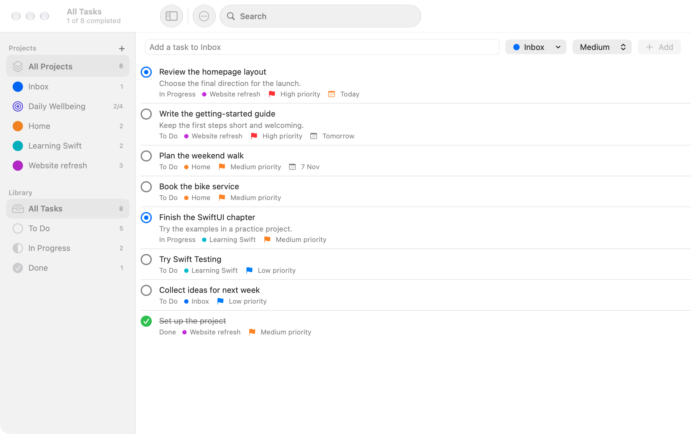
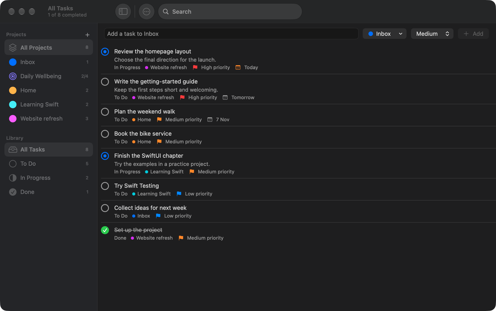

# Tickoff

A small, native task manager for macOS, written in Swift with SwiftUI and a local SQLite database. It started as a learning project (first in Rust with egui, now rewritten natively): a place to try a vertical-slice code layout and macOS-style UI polish.

> **Built with Claude Code.** This project was developed with [Claude Code](https://claude.com/claude-code), Anthropic's AI coding assistant, working interactively with the author.

> **Coming from the Rust version?** The Swift app opens the same `~/.hello_gui/tasks.db`, so your tasks and settings carry over unchanged. The last Rust version is the git tag `v0.1.0-rust`. Windows and Linux are no longer supported.

## User documentation

Visit **[the Tickoff website](https://fiqriismail.github.io/tickoff/)** for the
product overview and complete user guides:

- [Getting started](https://fiqriismail.github.io/tickoff/guide/getting-started/)
- [Tasks](https://fiqriismail.github.io/tickoff/guide/tasks/) and [Projects](https://fiqriismail.github.io/tickoff/guide/projects/)
- [Daily Goals](https://fiqriismail.github.io/tickoff/guide/daily-goals/)
- [Keyboard shortcuts](https://fiqriismail.github.io/tickoff/guide/keyboard-shortcuts/) and [display options](https://fiqriismail.github.io/tickoff/guide/appearance/)
- [Data and backups](https://fiqriismail.github.io/tickoff/help/data-and-backups/) and [Troubleshooting](https://fiqriismail.github.io/tickoff/help/troubleshooting/)

## Screenshots

| Light | Dark |
|---|---|
|  |  |

## Features

- Tasks with notes, priorities, statuses and optional due dates
- Projects, quick-add destinations, scoped search and status filters
- Daily Goals with check-offs, whole-number counters and fresh local-day progress
- Native macOS menus, system appearance, note previews and compact rows
- Stays fast with 10,000+ tasks: the list only builds the rows on screen
- All data is stored locally in a SQLite file. There is no account and no network access

## Download

Grab `Tickoff-<version>-macos-universal.zip` from the [latest release](https://github.com/fiqriismail/tickoff/releases/latest) (Apple Silicon and Intel), unzip it and drag `Tickoff.app` to Applications. It needs macOS 14 Sonoma or later.

Releases are ad-hoc signed, not Developer ID signed or notarised. If macOS blocks
the first launch, follow the
[approval instructions](https://fiqriismail.github.io/tickoff/help/troubleshooting/#macos-blocks-the-first-launch).

## Requirements

- macOS 14 Sonoma or later
- **Xcode 16 or newer** (the project uses Swift 6 language mode). The only dependency, [GRDB](https://github.com/groue/GRDB.swift), is fetched by Swift Package Manager on the first build, so you need network access once.

## Build, test and run

```sh
git clone https://github.com/fiqriismail/tickoff.git tickoff
cd tickoff
open Tickoff.xcodeproj    # then press ⌘R in Xcode to run, ⌘U to test
```

Or from the command line:

```sh
xcodebuild build -project Tickoff.xcodeproj -scheme Tickoff -destination 'platform=macOS'
xcodebuild test  -project Tickoff.xcodeproj -scheme Tickoff -destination 'platform=macOS'
```

Tests use an in-memory database, and the app does the same while they run, so they never touch your real tasks.

## Documentation website

The user documentation website uses Astro + Starlight. See
[website/README.md](website/README.md) for requirements, local preview, production
build and contribution instructions. The site is live at
<https://fiqriismail.github.io/tickoff/>. The Website workflow validates pull requests
and publishes relevant main changes after successful validation. See the
[deployment controls](website/README.md#github-actions-and-publishing).

## Release build

```sh
packaging/macos/release.sh
```

This archives the app in Release, ad-hoc signs it and writes `dist/Tickoff-<version>-macos-universal.zip` (arm64 and x86_64). The version is `MARKETING_VERSION` in the Xcode project. Set `ARCHS=arm64` to build for Apple Silicon only; the zip is then named `...-macos-arm64.zip`. `packaging/macos/make_icon.swift` regenerates the app icon artwork.

## Where your data lives

Projects, tasks and settings are stored in a single SQLite file in your home directory:

| OS | Path |
|---|---|
| macOS | `~/.hello_gui/tasks.db` |

The folder is created on first run. To back up your data, quit all Tickoff
instances and database tools, then copy the entire `~/.hello_gui/` folder,
including any SQLite sidecars. Do not copy just a live database file. To start
fresh, back up and move the closed app's data folder aside rather than deleting it.
See the [data and backups guide](https://fiqriismail.github.io/tickoff/help/data-and-backups/)
for safe restore steps; restoring replaces current data rather than merging it.

The first launch of a version with projects adds a `projects` table and a `project_id` column on tasks; your existing tasks move into a default **Inbox** project. The change only adds to the file, so an older build can still open it. Deleting a project deletes its tasks, after a confirmation that shows how many.

Daily Goals adds a `kind` column to projects and separate `daily_goals` and
`daily_goal_progress` tables. Existing projects default to Tasks. Daily progress stores a
snapshot of its goal's name, tracking style and target, so later edits do not reinterpret
recorded results.

## Project layout

The code is organised as vertical slices: each feature owns its UI and logic, and features never import each other. The app shell wires them together.

```
Tickoff/
├── App/                  the shell
│   ├── TickoffApp.swift      app entry point and the main window scene
│   ├── AppModel.swift        owns the database, loaded tasks and projects, the selected project, routes outcomes
│   ├── ContentView.swift     sidebar/detail layout, edit and project sheets, menu-command routing
│   ├── AppCommands.swift     menu bar commands and the About panel
│   └── ErrorBanner.swift     database error banner
├── Features/             one folder per feature
│   ├── AddTask/              quick-add bar
│   ├── DailyGoals/           Today view, goal editor, daily refresh and cached summaries
│   ├── EditTask/             edit sheet and validation
│   ├── Filters/              sidebar: project scope and status filters
│   ├── Projects/             sidebar Projects section, project sheet and draft
│   ├── Settings/             display options and their persistence
│   └── TaskList/             toolbar, search, task rows, due labels
├── Shared/               used by more than one feature
│   ├── AppDatabase.swift     opens the database and runs migrations
│   ├── DailyGoal.swift       goal definitions, daily snapshots and tracking styles
│   ├── DailyGoalStore.swift  goal and daily-progress SQL; history-preserving writes
│   ├── TaskStore.swift       every SQL statement for tasks
│   ├── Task.swift            Task, Status and Priority types
│   ├── Project.swift         Project, ProjectScope and ProjectError types
│   ├── ProjectStore.swift    every SQL statement for projects
│   ├── TaskSet.swift         the loaded tasks plus cached search keys and per-project counts
│   ├── Outcome.swift         how features report success or failure to the shell
│   └── Theme.swift           display options (Show Notes, Compact Rows)
└── Resources/            asset catalog (app icon, accent colour)
TickoffTests/             Swift Testing unit tests
packaging/macos/          release script and icon generator
```

Main dependency: [GRDB](https://github.com/groue/GRDB.swift) for SQLite. Everything else is Apple frameworks.

## License

Released under the [MIT License](LICENSE). You are free to use, copy, modify, merge, publish, distribute, sublicense and even sell this software, as long as the copyright notice and license text are kept with it.
