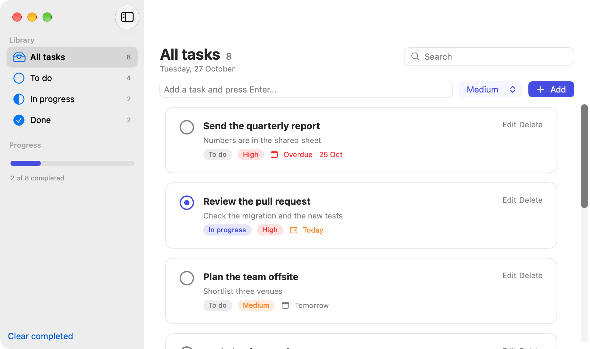
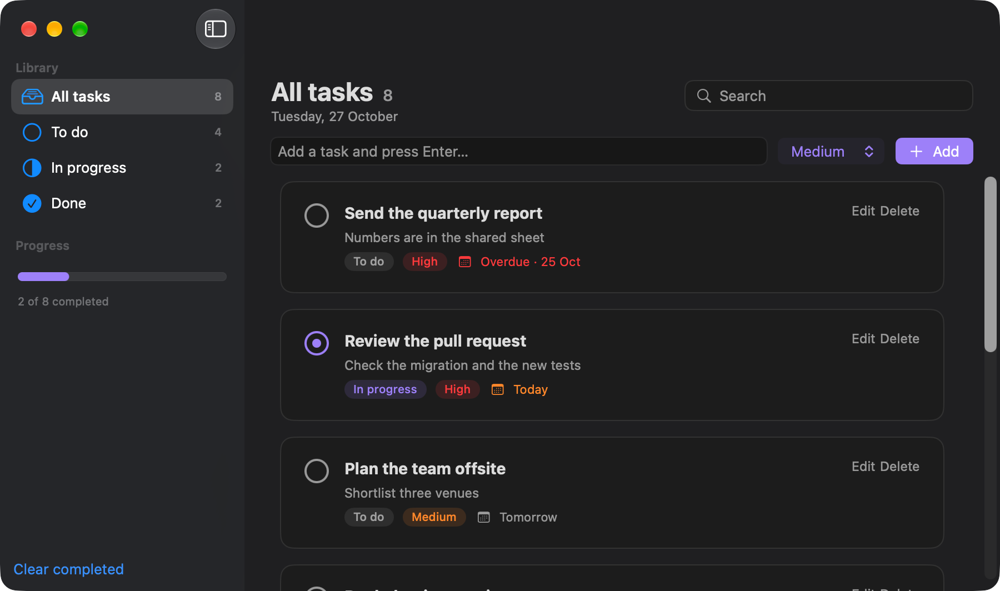

# Tickoff

A small, native task manager for macOS, written in Swift with SwiftUI and a local SQLite database. It started as a learning project (first in Rust with egui, now rewritten natively): a place to try a vertical-slice code layout and macOS-style UI polish.

> **Built with Claude Code.** This project was developed with [Claude Code](https://claude.com/claude-code), Anthropic's AI coding assistant, working interactively with the author.

> **Coming from the Rust version?** The Swift app opens the same `~/.hello_gui/tasks.db`, so your tasks and settings carry over unchanged. The last Rust version is the git tag `v0.1.0-rust`. Windows and Linux are no longer supported.

## Screenshots

| Light | Dark |
|---|---|
|  |  |

## Features

- Add, edit, complete and delete tasks, each with a title, notes, priority (Low / Medium / High), status (To do / In progress / Done) and optional due date
- Sidebar filters by status with live counts, a progress summary and "Clear completed"
- Search across titles and notes
- Right-click a task for a context menu; click a status pill to move it to the next status
- Settings: light / dark / follow-system theme, accent colour (System, Indigo, Violet, Teal, Rose, Orange), text size, compact cards, and a toggle for note previews
- Hide or show the sidebar, and resize it
- Native macOS menu bar and window conventions
- Stays fast with 10,000+ tasks: the list only builds the rows on screen
- All data is stored locally in a SQLite file. There is no account and no network access

## Keyboard shortcuts

| Action | Shortcut |
|---|---|
| New task | ⌘N |
| Find tasks | ⌘F |
| Settings | ⌘, |
| Hide / show sidebar | ⌃⌘S |

In the Edit sheet, Enter in the title field saves and Esc cancels.

## Download

Grab `Tickoff-<version>-macos-universal.zip` from the [latest release](https://github.com/fiqriismail/tickoff/releases/latest) (Apple Silicon and Intel), unzip it and drag `Tickoff.app` to Applications. It needs macOS 14 Sonoma or later.

The app is not signed with an Apple Developer ID, so macOS blocks it the first time. Right-click `Tickoff.app`, choose **Open**, then confirm. Or run `xattr -cr /Applications/Tickoff.app` once in Terminal.

## Requirements

- macOS 14 Sonoma or later
- **Xcode 16 or newer** (the project uses Swift 6 language mode). The only dependency, [GRDB](https://github.com/groue/GRDB.swift), is fetched by Swift Package Manager on the first build, so you need network access once.

## Build, test and run

```sh
git clone https://github.com/fiqriismail/tickoff.git tickoff
cd tickoff
open Tickoff.xcodeproj    # then press ⌘R in Xcode to run, ⌘U to test
```

Or from the command line:

```sh
xcodebuild build -project Tickoff.xcodeproj -scheme Tickoff -destination 'platform=macOS'
xcodebuild test  -project Tickoff.xcodeproj -scheme Tickoff -destination 'platform=macOS'
```

Tests use an in-memory database, and the app does the same while they run, so they never touch your real tasks.

## Release build

```sh
packaging/macos/release.sh
```

This archives the app in Release, ad-hoc signs it and writes `dist/Tickoff-<version>-macos-universal.zip` (arm64 and x86_64). The version is `MARKETING_VERSION` in the Xcode project. Set `ARCHS=arm64` to build for Apple Silicon only; the zip is then named `...-macos-arm64.zip`. `packaging/macos/make_icon.swift` regenerates the app icon artwork.

## Where your data lives

Tasks and settings are stored in a single SQLite file in your home directory:

| OS | Path |
|---|---|
| macOS | `~/.hello_gui/tasks.db` |

The folder is created on first run. To back up your tasks, copy that file. To start fresh, delete it while the app is closed.

## Project layout

The code is organised as vertical slices: each feature owns its UI and logic, and features never import each other. The app shell wires them together.

```
Tickoff/
├── App/                  the shell
│   ├── TickoffApp.swift      app entry point and scenes (main window, Settings)
│   ├── AppModel.swift        owns the database and loaded tasks, routes outcomes
│   ├── ContentView.swift     sidebar/detail layout, edit sheet, menu-command routing
│   ├── AppCommands.swift     menu bar commands and the About panel
│   └── ErrorBanner.swift     database error banner
├── Features/             one folder per feature
│   ├── AddTask/              quick-add bar
│   ├── EditTask/             edit sheet and validation
│   ├── Filters/              sidebar: filters, progress, clear completed
│   ├── Settings/             Settings window and its persistence
│   └── TaskList/             header, search, task cards, due labels
├── Shared/               used by more than one feature
│   ├── AppDatabase.swift     opens the database and runs migrations
│   ├── TaskStore.swift       every SQL statement for tasks
│   ├── Task.swift            Task, Status and Priority types
│   ├── TaskSet.swift         the loaded tasks plus cached search keys and counts
│   ├── Outcome.swift         how features report success or failure to the shell
│   └── Theme.swift           appearance preferences, accent colours, text scaling
└── Resources/            asset catalog (app icon, accent colour)
TickoffTests/             Swift Testing unit tests
packaging/macos/          release script and icon generator
```

Main dependency: [GRDB](https://github.com/groue/GRDB.swift) for SQLite. Everything else is Apple frameworks.

## License

Released under the [MIT License](LICENSE). You are free to use, copy, modify, merge, publish, distribute, sublicense and even sell this software, as long as the copyright notice and license text are kept with it.
