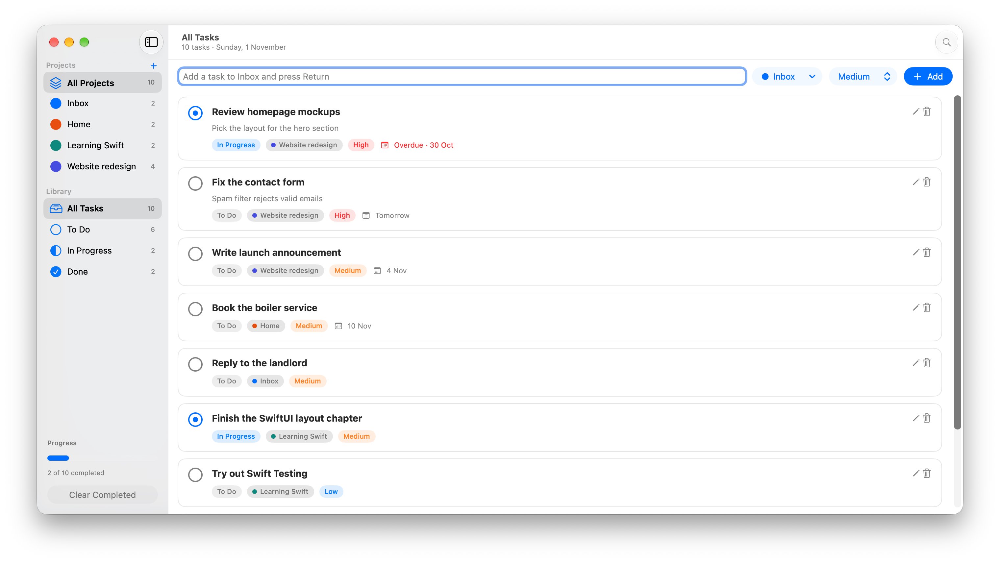
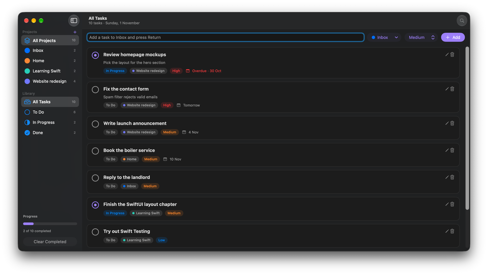

# Tickoff

A small, native task manager for macOS, written in Swift with SwiftUI and a local SQLite database. It started as a learning project (first in Rust with egui, now rewritten natively): a place to try a vertical-slice code layout and macOS-style UI polish.

> **Built with Claude Code.** This project was developed with [Claude Code](https://claude.com/claude-code), Anthropic's AI coding assistant, working interactively with the author.

> **Coming from the Rust version?** The Swift app opens the same `~/.hello_gui/tasks.db`, so your tasks and settings carry over unchanged. The last Rust version is the git tag `v0.1.0-rust`. Windows and Linux are no longer supported.

## Screenshots

| Light | Dark |
|---|---|
|  |  |

## Features

- Add, edit, complete and delete tasks, each with a title, notes, priority (Low / Medium / High), status (To do / In progress / Done) and optional due date
- Projects: every task belongs to one project. The sidebar scopes the list to a project (or All Projects), with a colour dot and live count per project. Create, edit, archive and delete projects from the sidebar "+" or File > New Project…; the edit sheet can move a task
- Daily Goals projects: a dedicated Today view with daily check-offs and whole-number counters, fresh progress each local day, and a completed/total sidebar badge
- Quick-add: under All Projects a project menu (Inbox, your recent projects, then all projects) chooses where the task goes; inside a project, tasks go to that project
- Sidebar filters by status with live counts (within the chosen project). The toolbar shows progress for the selected project and a More menu with Clear Completed
- Search across titles and notes
- Right-click a task for a context menu (Edit, Change Status, Delete); Return or double-click opens it, and the Task menu has the same commands
- Follows the system light / dark appearance and accent colour; Show Notes and Use Compact Rows are in the toolbar More menu and the View menu
- Hide or show the sidebar, and resize it
- Native macOS menu bar and window conventions
- Stays fast with 10,000+ tasks: the list only builds the rows on screen
- All data is stored locally in a SQLite file. There is no account and no network access

## Keyboard shortcuts

| Action | Shortcut |
|---|---|
| New task | ⌘N |
| New project | ⇧⌘N |
| New goal (inside a Daily Goals project) | ⇧⌘G |
| Find tasks | ⌘F |
| Edit task | ⌘E |
| Delete task | ⌘⌫ |
| Hide / show sidebar | ⌃⌘S |

In the Edit sheet, Enter in the title field saves and Esc cancels.

## Daily Goals

Choose **Daily Goals** in the New Project sheet, then select that project in the sidebar.
Use **New Goal** to add either a daily check-off or a counter with a positive whole-number
target. Counters have +1 / -1 controls, never go below zero, and can exceed their target.
Select a goal to use the Goal menu, or open its row's More menu to edit or remove it.

Each local calendar day starts fresh, without carrying forward incomplete goals. Progress
is saved separately from ordinary tasks and does not affect task searches or status counts.
Edits to a goal apply tomorrow; today's definition and progress remain unchanged. Removing
a goal hides it from Today but keeps its history. Archiving a project hides it and stops daily
updates; deleting the project also keeps recorded goal history.

This first version displays Today only; history browsing, streaks and charts are not included.
Existing projects remain task projects, and project types cannot be converted.

## Download

Grab `Tickoff-<version>-macos-universal.zip` from the [latest release](https://github.com/fiqriismail/tickoff/releases/latest) (Apple Silicon and Intel), unzip it and drag `Tickoff.app` to Applications. It needs macOS 14 Sonoma or later.

The app is not signed with an Apple Developer ID, so macOS blocks it the first time. Right-click `Tickoff.app`, choose **Open**, then confirm. Or run `xattr -cr /Applications/Tickoff.app` once in Terminal.

## Requirements

- macOS 14 Sonoma or later
- **Xcode 16 or newer** (the project uses Swift 6 language mode). The only dependency, [GRDB](https://github.com/groue/GRDB.swift), is fetched by Swift Package Manager on the first build, so you need network access once.

## Build, test and run

```sh
git clone https://github.com/fiqriismail/tickoff.git tickoff
cd tickoff
open Tickoff.xcodeproj    # then press ⌘R in Xcode to run, ⌘U to test
```

Or from the command line:

```sh
xcodebuild build -project Tickoff.xcodeproj -scheme Tickoff -destination 'platform=macOS'
xcodebuild test  -project Tickoff.xcodeproj -scheme Tickoff -destination 'platform=macOS'
```

Tests use an in-memory database, and the app does the same while they run, so they never touch your real tasks.

## Documentation website

The user documentation website uses Astro + Starlight. See
[website/README.md](website/README.md) for requirements, local preview, production
build and contribution instructions. GitHub Pages publishing is tracked in
[#60](https://github.com/fiqriismail/tickoff/issues/60); the site is not published yet.

## Release build

```sh
packaging/macos/release.sh
```

This archives the app in Release, ad-hoc signs it and writes `dist/Tickoff-<version>-macos-universal.zip` (arm64 and x86_64). The version is `MARKETING_VERSION` in the Xcode project. Set `ARCHS=arm64` to build for Apple Silicon only; the zip is then named `...-macos-arm64.zip`. `packaging/macos/make_icon.swift` regenerates the app icon artwork.

## Where your data lives

Projects, tasks and settings are stored in a single SQLite file in your home directory:

| OS | Path |
|---|---|
| macOS | `~/.hello_gui/tasks.db` |

The folder is created on first run. To back up your tasks, copy that file. To start fresh, delete it while the app is closed.

The first launch of a version with projects adds a `projects` table and a `project_id` column on tasks; your existing tasks move into a default **Inbox** project. The change only adds to the file, so an older build can still open it. Deleting a project deletes its tasks, after a confirmation that shows how many.

Daily Goals adds a `kind` column to projects and separate `daily_goals` and
`daily_goal_progress` tables. Existing projects default to Tasks. Daily progress stores a
snapshot of its goal's name, tracking style and target, so later edits do not reinterpret
recorded results.

## Project layout

The code is organised as vertical slices: each feature owns its UI and logic, and features never import each other. The app shell wires them together.

```
Tickoff/
├── App/                  the shell
│   ├── TickoffApp.swift      app entry point and the main window scene
│   ├── AppModel.swift        owns the database, loaded tasks and projects, the selected project, routes outcomes
│   ├── ContentView.swift     sidebar/detail layout, edit and project sheets, menu-command routing
│   ├── AppCommands.swift     menu bar commands and the About panel
│   └── ErrorBanner.swift     database error banner
├── Features/             one folder per feature
│   ├── AddTask/              quick-add bar
│   ├── DailyGoals/           Today view, goal editor, daily refresh and cached summaries
│   ├── EditTask/             edit sheet and validation
│   ├── Filters/              sidebar: project scope and status filters
│   ├── Projects/             sidebar Projects section, project sheet and draft
│   ├── Settings/             display options and their persistence
│   └── TaskList/             toolbar, search, task rows, due labels
├── Shared/               used by more than one feature
│   ├── AppDatabase.swift     opens the database and runs migrations
│   ├── DailyGoal.swift       goal definitions, daily snapshots and tracking styles
│   ├── DailyGoalStore.swift  goal and daily-progress SQL; history-preserving writes
│   ├── TaskStore.swift       every SQL statement for tasks
│   ├── Task.swift            Task, Status and Priority types
│   ├── Project.swift         Project, ProjectScope and ProjectError types
│   ├── ProjectStore.swift    every SQL statement for projects
│   ├── TaskSet.swift         the loaded tasks plus cached search keys and per-project counts
│   ├── Outcome.swift         how features report success or failure to the shell
│   └── Theme.swift           display options (Show Notes, Compact Rows)
└── Resources/            asset catalog (app icon, accent colour)
TickoffTests/             Swift Testing unit tests
packaging/macos/          release script and icon generator
```

Main dependency: [GRDB](https://github.com/groue/GRDB.swift) for SQLite. Everything else is Apple frameworks.

## License

Released under the [MIT License](LICENSE). You are free to use, copy, modify, merge, publish, distribute, sublicense and even sell this software, as long as the copyright notice and license text are kept with it.
