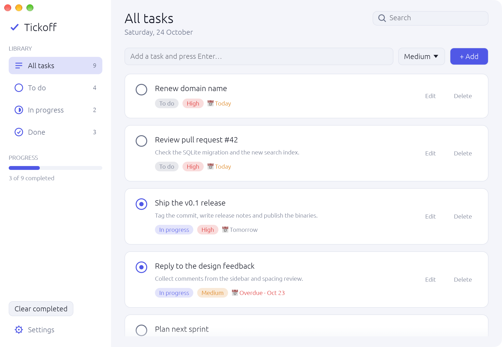
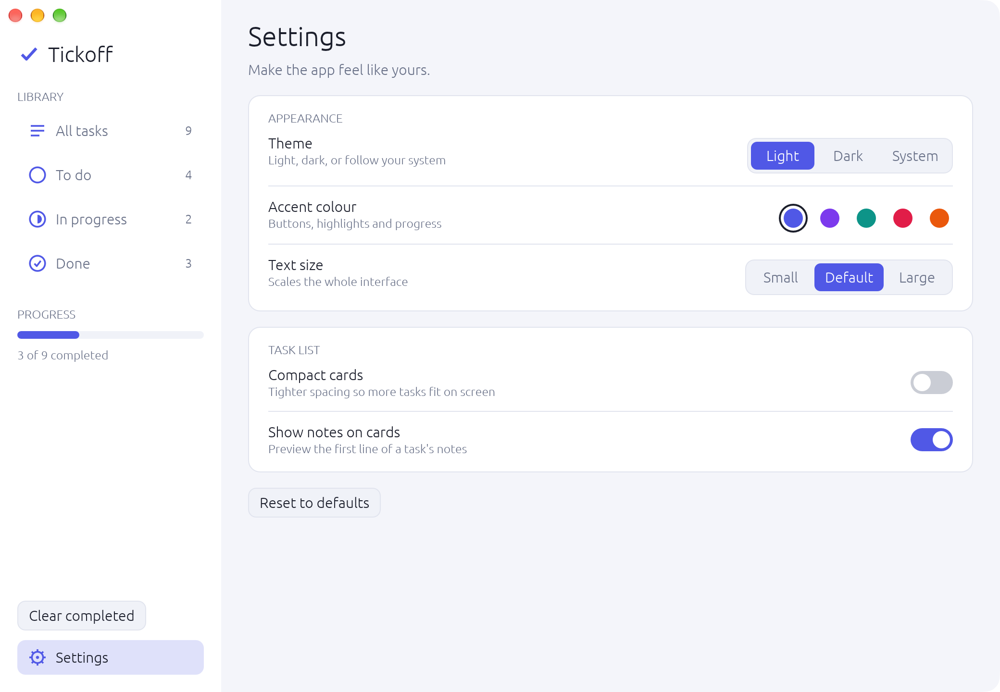
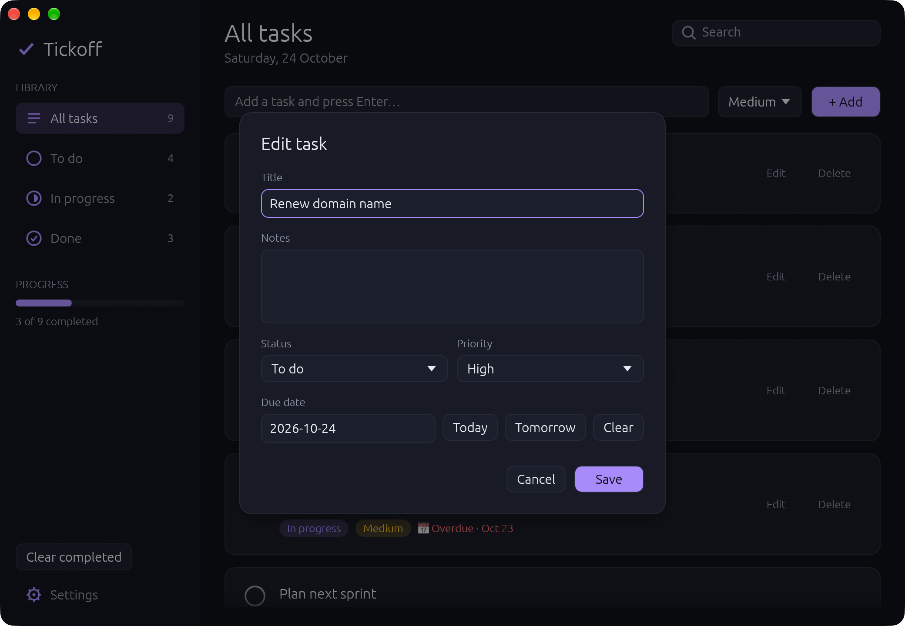

# Tickoff

A small, modern-looking desktop task manager written in Rust with [egui](https://github.com/emilk/egui) (via `eframe`) and SQLite. It started as a learning project: a place to try egui, a vertical-slice code layout, and macOS-style UI polish.

> **Built with Claude Code.** This project was developed with [Claude Code](https://claude.com/claude-code), Anthropic's AI coding assistant, working interactively with the author.

## Screenshots

| Light | Dark |
|---|---|
|  |  |
|  |  |

## Features

- Add, edit, complete and delete tasks, each with a title, notes, priority (Low / Medium / High), status (To do / In progress / Done) and optional due date
- Sidebar filters by status with live counts, a progress summary and "Clear completed"
- Search across titles and notes
- Right-click a task for a context menu; click a status pill to move it to the next status
- Settings page: light / dark / follow-system theme, five accent colours, text size, compact cards, and a toggle for note previews
- Hide or show the sidebar, and resize it
- Native macOS menu bar and window conventions (unified title bar, standard shortcuts); keyboard-shortcut equivalents on Windows and Linux
- Stays fast with 10,000+ tasks: only the cards on screen are drawn
- All data is stored locally in a SQLite file. There is no account and no network access

## Keyboard shortcuts

| Action | macOS | Windows / Linux |
|---|---|---|
| New task | ⌘N | Ctrl+N |
| Find tasks | ⌘F | Ctrl+F |
| Settings | ⌘, | Ctrl+, |
| Hide / show sidebar | ⌃⌘S | Ctrl+Alt+S |

In the Edit dialog, Enter in the title field saves and Esc cancels.

## Download (macOS)

Grab `Tickoff-<version>-macos-arm64.zip` from the [latest release](https://github.com/fiqriismail/tickoff/releases/latest) (Apple Silicon), unzip it and drag `Tickoff.app` to Applications.

The app is not signed with an Apple Developer ID, so macOS blocks it the first time. Right-click `Tickoff.app`, choose **Open**, then confirm. Or run `xattr -cr /Applications/Tickoff.app` once in Terminal.

For Intel Macs, Windows and Linux, build from source as described below.

## Requirements

- **Rust 1.85 or newer** (the project uses the 2024 edition). Install it with [rustup](https://rustup.rs).
- A **C compiler**, because SQLite is compiled from source (the `bundled` feature), so you don't need SQLite installed. Each platform's setup is below.

## Setup and run

First get the code:

```sh
git clone https://github.com/fiqriismail/tickoff.git tickoff
cd tickoff
```

Then follow the section for your system. On every platform the commands to run are the same:

```sh
cargo run --release    # build and start the app
cargo test             # run the unit tests
```

The first build downloads and compiles the dependencies, so it takes a few minutes. Later builds are fast. A debug build (`cargo run`) works but is noticeably slower with very large task lists, so prefer `--release` for anything beyond a quick try.

The built program is named `Tickoff` and ends up in `target/release/`.

### macOS

1. Install the Xcode command line tools (provides the C compiler):
   ```sh
   xcode-select --install
   ```
2. Install Rust from [rustup.rs](https://rustup.rs).
3. Run `cargo run --release`.

The app was developed and tested on macOS, and this is the only platform where it has been run.

### Windows

1. Install Rust from [rustup.rs](https://rustup.rs). When prompted, accept the default MSVC toolchain.
2. Install the **Visual Studio Build Tools** (or Visual Studio) with the **"Desktop development with C++"** workload. This provides the MSVC compiler and Windows SDK that Rust and the bundled SQLite need.
3. In PowerShell or Command Prompt, run `cargo run --release`.

### Linux

1. Install Rust from [rustup.rs](https://rustup.rs).
2. Install a C compiler and the windowing and graphics libraries egui needs.

   Debian / Ubuntu:
   ```sh
   sudo apt update
   sudo apt install build-essential pkg-config libxkbcommon-dev libxkbcommon-x11-dev \
     libwayland-dev libx11-dev libxcursor-dev libxrandr-dev libxi-dev libgl1-mesa-dev
   ```

   Fedora:
   ```sh
   sudo dnf install gcc pkgconf-pkg-config libxkbcommon-devel libxkbcommon-x11-devel \
     wayland-devel libX11-devel libXcursor-devel libXrandr-devel libXi-devel mesa-libGL-devel
   ```
3. Run `cargo run --release`.

Package names vary between distributions. If the build stops on a missing library, install that library's `-dev` / `-devel` package and try again.

> **Windows and Linux are untested.** The code compiles its macOS-only parts (the native menu) conditionally and falls back to in-window shortcuts elsewhere, but I have not run it on those systems. If something fails, please open an issue with the error output.

## Where your data lives

Tasks and settings are stored in a single SQLite file in your home directory:

| OS | Path |
|---|---|
| macOS / Linux | `~/.hello_gui/tasks.db` |
| Windows | `C:\Users\<you>\.hello_gui\tasks.db` |

The folder is created on first run. To back up your tasks, copy that file. To start fresh, delete it while the app is closed.

## Project layout

The code is organised as vertical slices: each feature owns its UI and logic, and features never import each other. The app shell wires them together.

```
src/
├── main.rs              window setup and startup
├── app.rs               shell: layout, routing between features, owns the database connection
├── menu.rs              native macOS menu bar / shortcuts on other platforms
├── features/
│   ├── add_task.rs      quick-add bar
│   ├── edit_task.rs     edit dialog and validation
│   ├── filters.rs       sidebar: filters, progress, clear completed
│   ├── settings/        settings page and its persistence
│   └── task_list/       header, search, and the virtualised list of task cards
└── shared/              used by more than one feature
    ├── db.rs            opens the database and creates the tables
    ├── tasks.rs         every SQL statement for tasks, plus the loaded TaskSet
    ├── task.rs          Task, Status and Priority types
    ├── theme.rs         palette, accent colours and egui styling
    ├── icons.rs         vector sidebar icons
    ├── widgets.rs       small reusable widgets
    └── outcome.rs       how features report success or failure to the shell
```

Main dependencies: [`eframe`](https://crates.io/crates/eframe) / egui for the UI, [`rusqlite`](https://crates.io/crates/rusqlite) for storage, [`chrono`](https://crates.io/crates/chrono) for dates, [`dirs`](https://crates.io/crates/dirs) for the home directory, and [`muda`](https://crates.io/crates/muda) for the native menu on macOS.

## Development

```sh
cargo fmt                    # format
cargo clippy --all-targets   # lint
cargo test                   # unit tests (in-memory SQLite, no setup needed)
packaging/macos/bundle.sh    # macOS only: build dist/Tickoff.app and a release zip
```

## License

Released under the [MIT License](LICENSE). You are free to use, copy, modify, merge, publish, distribute, sublicense and even sell this software, as long as the copyright notice and license text are kept with it.
